# Krispy Tools for DaVinci Resolve

Free, open-source tools that take the repetitive parts out of editing in **DaVinci Resolve Studio**: subtitles and captions in every language, finding changes between two versions, rendering marker ranges, batch timeline jobs and more.

Every tool has a short demo video and real screenshots at **[resolve.krispytools.com](https://resolve.krispytools.com)**.

Made by Kristaps Prūsis, a video editor in Latvia, for his own work, and shared because they might save you time too.

## Tools

**Bundles:** [Resolve Text Toolkit (5 tools in 1)](#resolve-text-toolkit-5-tools-in-1) · [Resolve Automator (5 tools in 1)](#resolve-automator-5-tools-in-1)

**Captions and subtitles:** [Caption Titler](#caption-titler) · [SRT Replacer](#srt-replacer) · [Font Changer](#font-changer) · [Template Duplicator](#template-duplicator) · [Subtitle Creator](#subtitle-creator)

**Automation:** [Video Difference Marker](#video-difference-marker) · [Marker Range Render Queue](#marker-range-render-queue) · [Comments to Resolve Markers](#comments-to-resolve-markers) · [Batch Export](#batch-export) · [Timeline Renamer](#timeline-renamer) · [Marker Insert](#marker-insert) · [Track Overlay](#track-overlay) · [Marker Screenshots](#marker-screenshots)

**Utilities:** [YouTube Chapter Exporter](#youtube-chapter-exporter) · [Resolve Page Time Tracker](#resolve-page-time-tracker)

## Bundles

5 tools in 1: one window with 5 pages instead of 5 separate tools to install and open. Every tool inside is also available on its own below.

### Resolve Text Toolkit (5 tools in 1)

5 tools in 1: Caption Titler, SRT Replacer, Font Changer, Template Duplicator and Subtitle Creator in one window with 5 pages.

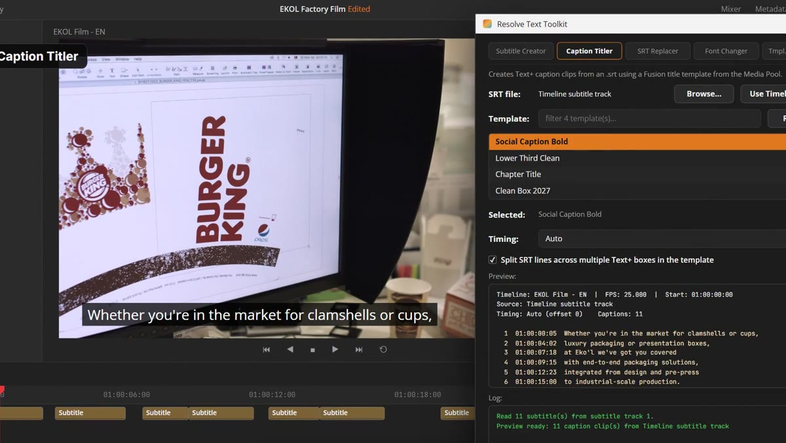

- Subtitle Creator turns rough Text+ clips into a real subtitle track and an SRT for YouTube.
- Caption Titler builds styled Text+ captions from subtitles using your own Fusion template, one clip per line.
- SRT Replacer swaps a translated SRT into the same caption clips, keeping style and timing.
- Font Changer switches every caption to another font in one go, for languages like Japanese.
- Template Duplicator moves every caption onto a new template without retyping.

[▶ Demo video](https://resolve.krispytools.com/tools/resolve-text-toolkit/) · [⬇ Resolve Text Toolkit.lua](tools/Bundles/Resolve%20Text%20Toolkit.lua) · [Tool page](https://resolve.krispytools.com/tools/resolve-text-toolkit/)

### Resolve Automator (5 tools in 1)

5 tools in 1: Timeline Renamer, Marker Screenshots, Marker Insert, Track Overlay and Batch Export in one window with 5 pages.

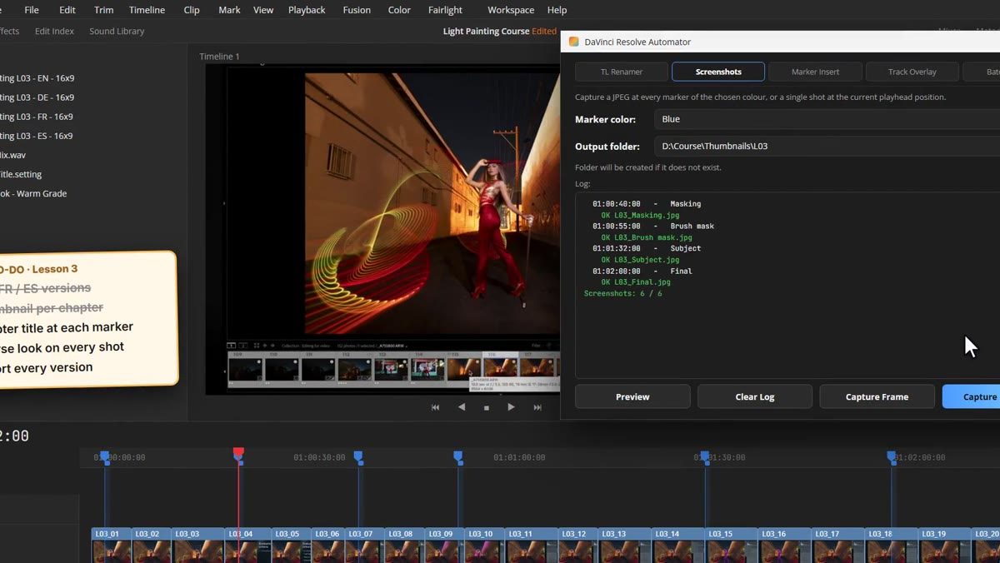

- Timeline Renamer: duplicate or rename many timelines with find and replace.
- Marker Screenshots: export a still at every marker, named after the marker.
- Marker Insert: drop a whoosh, title, graphic or video at every marker on its own track.
- Track Overlay: put an adjustment clip, graphic or sound over every shot, cut for cut.
- Batch Export: queue many timelines with one render preset.

[▶ Demo video](https://resolve.krispytools.com/tools/resolve-automator/) · [⬇ Resolve Automator.lua](tools/Bundles/Resolve%20Automator.lua) · [Tool page](https://resolve.krispytools.com/tools/resolve-automator/)

## Captions and subtitles

### Caption Titler

Build styled, animated Text+ captions from subtitles using your own title template.

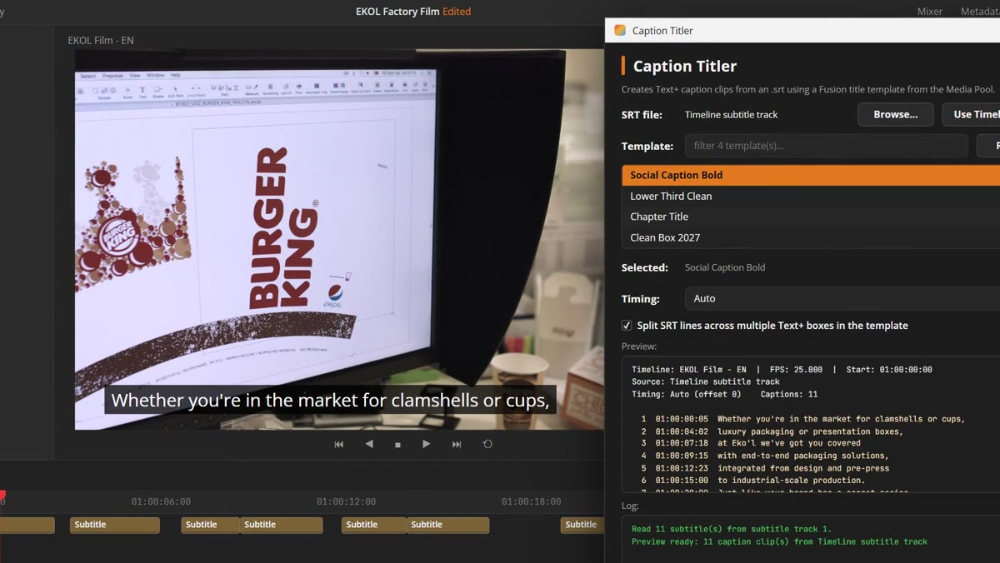

- Styled, animated captions for social, from any subtitle file.
- Uses your own Fusion title template, so every caption matches your look.
- One Text+ clip per line, timed to the frame.

[▶ Demo on YouTube](https://youtu.be/AJtufTwBprc) · [⬇ Caption Titler.lua](tools/Text/Caption%20Titler.lua) · [Tool page](https://resolve.krispytools.com/tools/caption-titler/)

### SRT Replacer

Swap your captions to another language from an SRT, keeping style and timing.

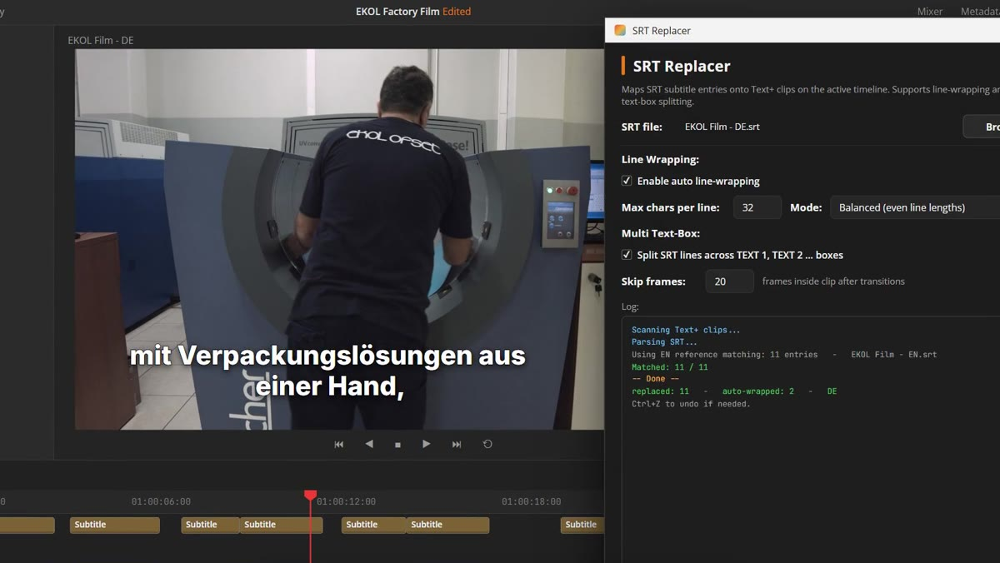

- A German, Spanish or Japanese version without retyping a caption.
- Style, animation and timing stay as they are; only the words change.
- Dry Run shows exactly how many clips will change first.

[▶ Demo on YouTube](https://youtu.be/G_YipSFSRSs) · [⬇ SRT Replacer.lua](tools/Text/SRT%20Replacer.lua) · [Tool page](https://resolve.krispytools.com/tools/srt-replacer/)

### Font Changer

Change the font on every Text+ clip in one click.

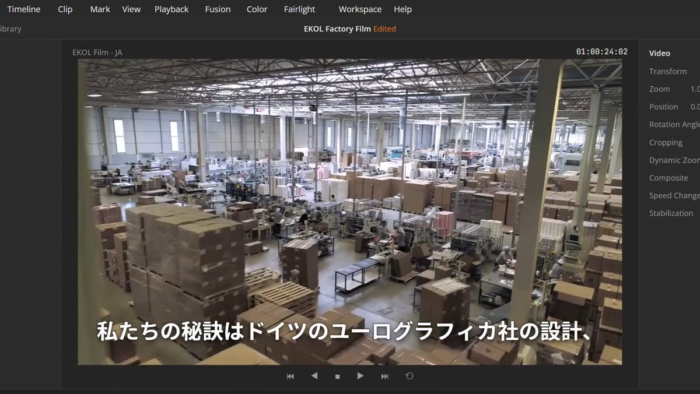

- Every caption to a new font in one click.
- Fixes the empty boxes you get when a Latin font meets Japanese text.
- Change only the clips that match an SRT, if you need to.

[▶ Demo on YouTube](https://youtu.be/njY6Przz3rk) · [⬇ Font Changer.lua](tools/Text/Font%20Changer.lua) · [Tool page](https://resolve.krispytools.com/tools/font-changer/)

### Template Duplicator

Move every caption onto another title template, keeping text and timing.

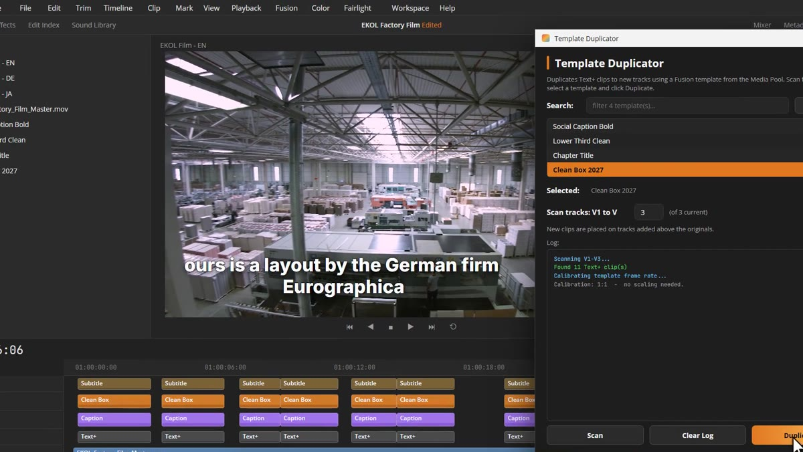

- A new look for every caption without retyping or retiming anything.
- Original clips stay as they are, the new ones go on tracks above.
- Works with any Fusion title template in your Media Pool.

[▶ Demo on YouTube](https://youtu.be/NIXifq0zRBc) · [⬇ Template Duplicator.lua](tools/Text/Template%20Duplicator.lua) · [Tool page](https://resolve.krispytools.com/tools/template-duplicator/)

### Subtitle Creator

Turn Text+ clips into a real Resolve subtitle track and an SRT file.

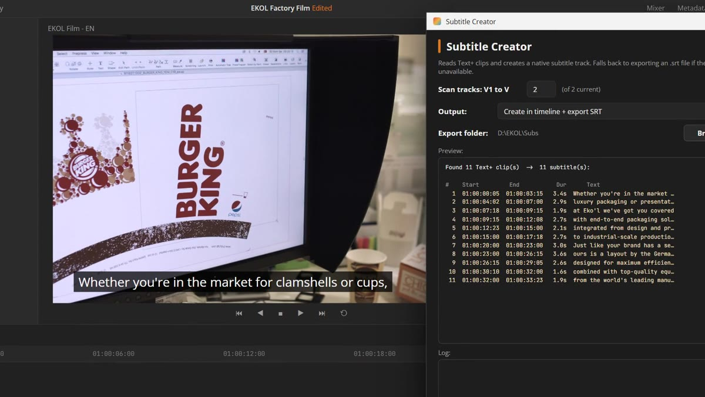

- Turns the Text+ clips you already typed into a real subtitle track.
- Saves an SRT file for YouTube, Vimeo or a client.
- Timing is taken from the clips, frame accurate.

[▶ Demo on YouTube](https://youtu.be/zyH0rNLEiVQ) · [⬇ Subtitle Creator.lua](tools/Text/Subtitle%20Creator.lua) · [Tool page](https://resolve.krispytools.com/tools/subtitle-creator/)

## Automation

### Video Difference Marker

Compare two video versions and add Resolve markers where visual changes occur.

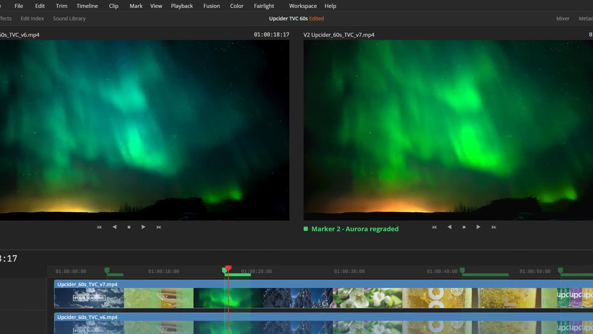

- Stack two versions of a cut and get a marker on every visual change.
- Finds swapped shots, regrades, added text and logos; identical stretches get no marker.
- Two-pass scan: a fast pass finds changed ranges, a frame-accurate pass places the markers.

[▶ Demo video](https://resolve.krispytools.com/tools/video-difference-marker/) · [⬇ Video Difference Marker.lua](tools/Automation/Video%20Difference%20Marker.lua) · [Tool page](https://resolve.krispytools.com/tools/video-difference-marker/)

### Marker Range Render Queue

Turn timeline marker ranges into named Deliver-page render jobs.

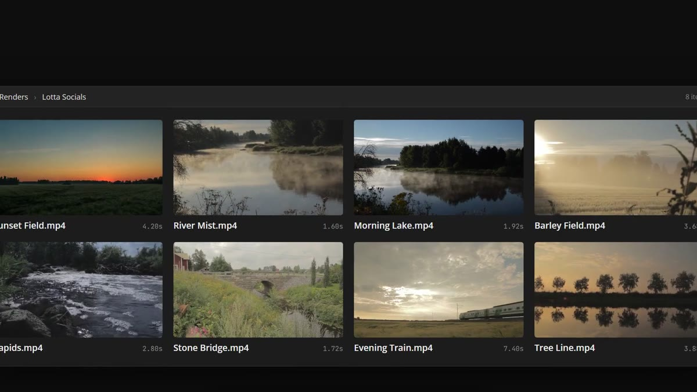

- Every duration marker becomes its own render job, named after the marker.
- Filter by marker colour, keep your render preset and output folder.
- Re-run after a revision instead of setting In/Out and file names by hand.

[▶ Demo on YouTube](https://youtu.be/Y5H6EdyOCh4) · [⬇ Marker Range Render Queue.lua](tools/Automation/Marker%20Range%20Render%20Queue.lua) · [Tool page](https://resolve.krispytools.com/tools/marker-range-render-queue/)

### Comments to Resolve Markers

Paste review notes from anywhere and turn them into Resolve timeline markers.

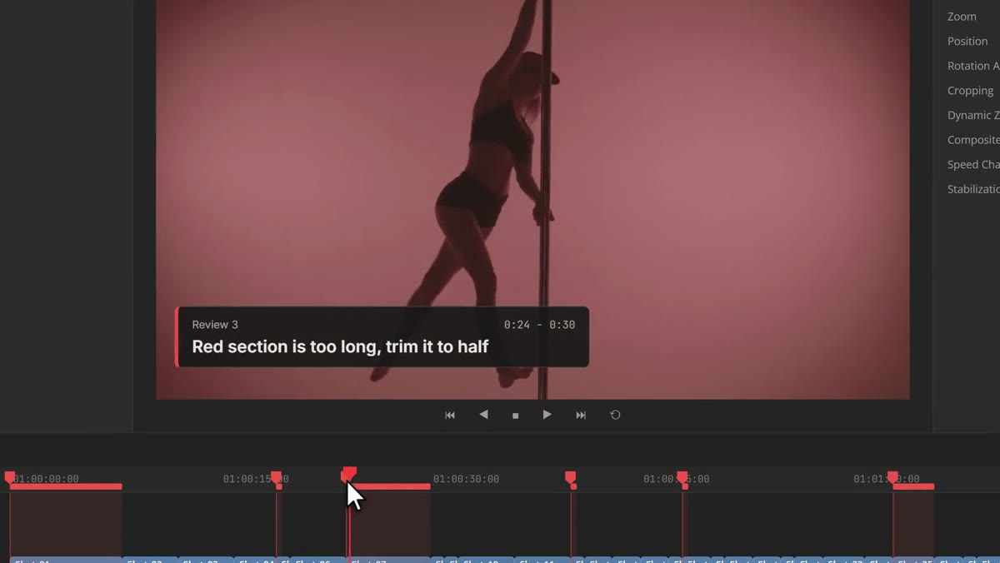

- Paste notes from email, docs, YouTube, Frame.io or a CSV and get one marker per note.
- Understands 0:39, [0:39], 00:00:39:12, 1m20s, ranges and comments that wrap onto the next line.
- Preview exactly where each note lands before adding.

[▶ Demo on YouTube](https://youtu.be/rFFb3p3x3r8) · [⬇ Comments to Resolve Markers.lua](tools/Utilities/Comments%20to%20Resolve%20Markers.lua) · [Tool page](https://resolve.krispytools.com/tools/comments-to-resolve-markers/)

### Batch Export

Queue many timelines for render with one preset and one output folder.

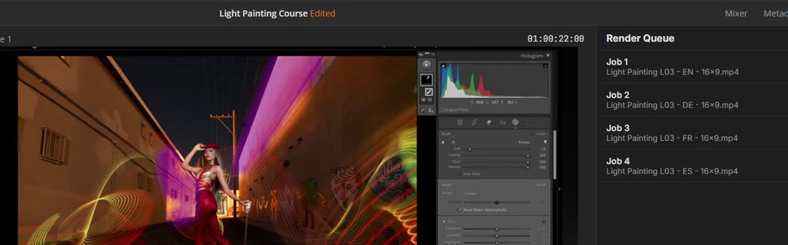

- Queue dozens of timelines in one click.
- Uses your own saved render preset, so the settings are always right.
- Each file is named after its timeline.

[▶ Demo on YouTube](https://youtu.be/164dyAUp2Qg) · [⬇ Batch Export.lua](tools/Automation/Batch%20Export.lua) · [Tool page](https://resolve.krispytools.com/tools/batch-export/)

### Timeline Renamer

Duplicate or rename many Resolve timelines at once with find and replace.

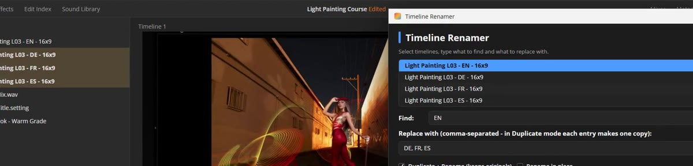

- Find and replace in the names of many timelines at once.
- Duplicate mode makes one copy per entry: v2, Client Review, 9x16, Final.
- Preview every new name before anything changes.

[▶ Demo on YouTube](https://youtu.be/2HFc1IR6s3k) · [⬇ Timeline Renamer.lua](tools/Automation/Timeline%20Renamer.lua) · [Tool page](https://resolve.krispytools.com/tools/timeline-renamer/)

### Marker Insert

Drop the same clip at every marker: a whoosh, a title, a graphic or a video.

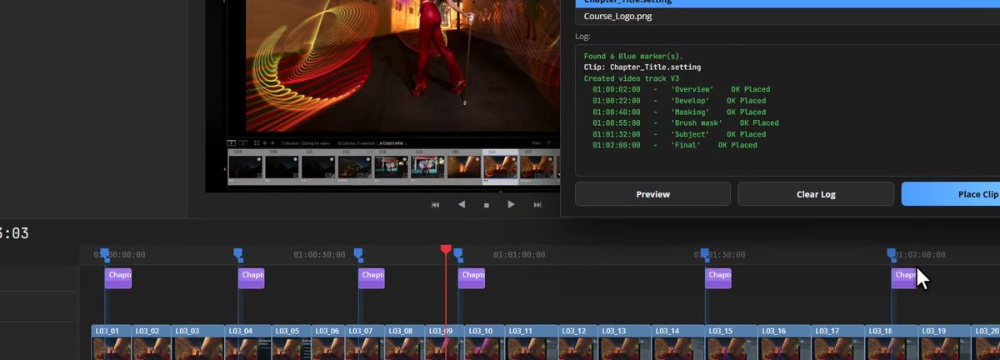

- Place a sound effect, title, graphic or video at every marker.
- A frame offset lets the clip land a few frames before or after each marker.
- Always uses a new track, so your edit stays as it is.

[▶ Demo video](https://resolve.krispytools.com/tools/marker-insert/) · [⬇ Marker Insert.lua](tools/Automation/Marker%20Insert.lua) · [Tool page](https://resolve.krispytools.com/tools/marker-insert/)

### Track Overlay

Cover every clip on a track with a template clip, cut for cut.

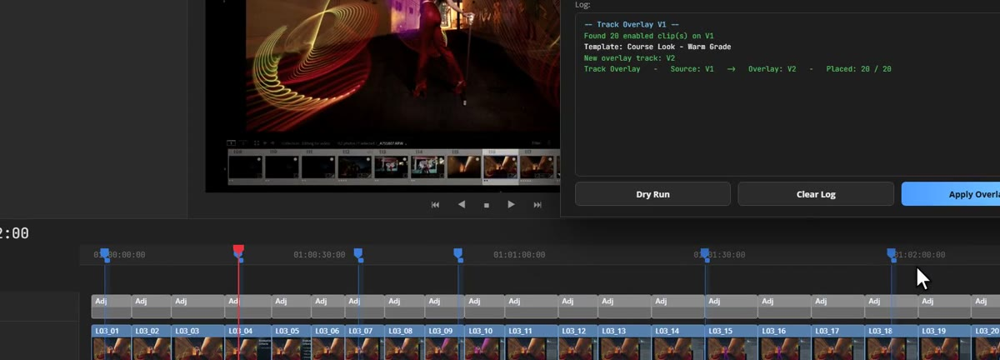

- An adjustment clip above every shot, ready for a per-shot grade, zoom or effect.
- Also works with graphics, video and audio, like a frame overlay or a whoosh on every cut.
- Dry Run lists exactly what will be placed before anything changes.

[▶ Demo video](https://resolve.krispytools.com/tools/track-overlay/) · [⬇ Track Overlay.lua](tools/Automation/Track%20Overlay.lua) · [Tool page](https://resolve.krispytools.com/tools/track-overlay/)

### Marker Screenshots

Save a still at every marker of one colour, named after the marker.

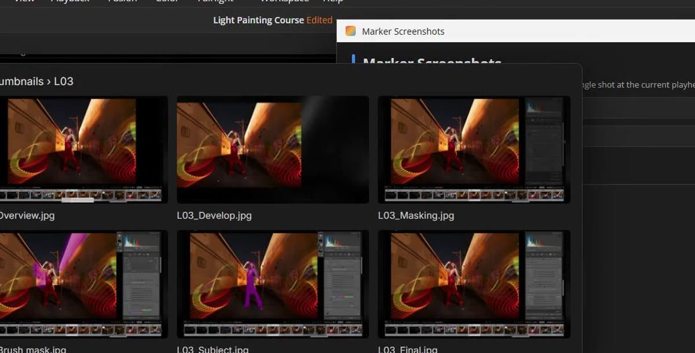

- One JPEG at every marker, named after the marker.
- Filter by marker colour so only the frames you want are saved.
- Review stills, thumbnails and chapter images in seconds.

[▶ Demo video](https://resolve.krispytools.com/tools/marker-screenshots/) · [⬇ Marker Screenshots.lua](tools/Automation/Marker%20Screenshots.lua) · [Tool page](https://resolve.krispytools.com/tools/marker-screenshots/)

## Utilities

### YouTube Chapter Exporter

Turn Resolve timeline markers into a ready-to-paste YouTube chapter list.

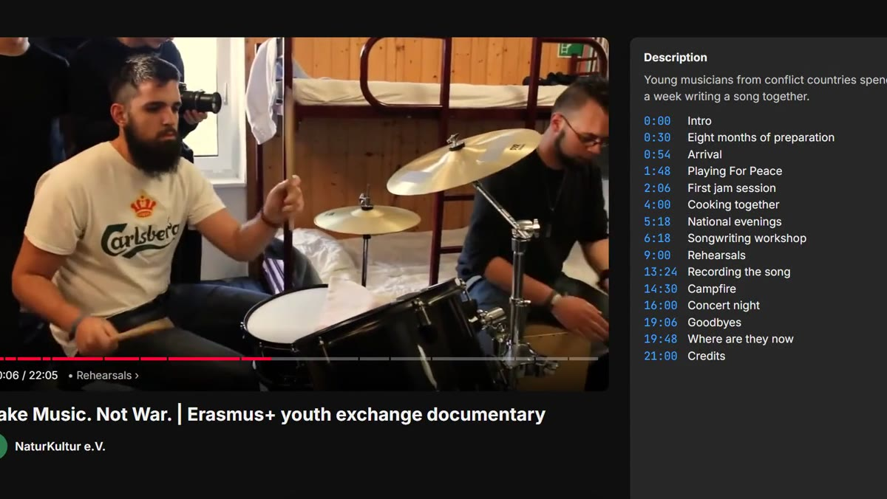

- Turns your chapter markers into a YouTube-ready chapter list.
- Filter by marker colour so your own notes stay out.
- Adds the 0:00 intro line YouTube needs and saves a .txt file.

[▶ Demo on YouTube](https://youtu.be/TniY1OCkV7o) · [⬇ YouTube Chapter Exporter.lua](tools/Utilities/YouTube%20Chapter%20Exporter.lua) · [Tool page](https://resolve.krispytools.com/tools/youtube-chapter-exporter/)

### Resolve Page Time Tracker

Track active editing time by Resolve page, session, and project.

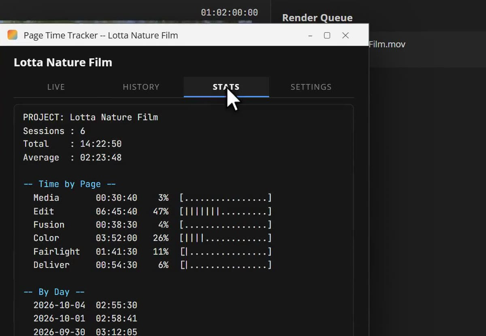

- Tracks how long you spend on each page: Edit, Color, Fairlight, Deliver.
- Pauses by itself when you are away and resumes when you are back.
- Per-project totals and CSV export for invoices; all data stays on your computer.

[▶ Demo video](https://resolve.krispytools.com/tools/resolve-page-time-tracker/) · [⬇ Resolve Page Time Tracker.lua](tools/Utilities/Resolve%20Page%20Time%20Tracker.lua) · [Tool page](https://resolve.krispytools.com/tools/resolve-page-time-tracker/)

## Install

1. Download the `.lua` file of the tool you want, or the whole repo as a ZIP (green **Code** button > Download ZIP).
2. Copy it into Resolve's Utility scripts folder:
   - **Windows:** `%APPDATA%\Blackmagic Design\DaVinci Resolve\Support\Fusion\Scripts\Utility\`
   - **macOS:** `~/Library/Application Support/Blackmagic Design/DaVinci Resolve/Fusion/Scripts/Utility/`
3. Restart Resolve and open the tool from **Workspace > Scripts > Utility**.

## Requirements

- **DaVinci Resolve Studio 19.1 or newer.** Since Resolve 19.1 the free version no longer lets scripts open their own window.
- Windows 10/11 or macOS 12+. One file works on both.
- Video Difference Marker also needs [FFmpeg](https://ffmpeg.org) installed.

Tested in Resolve Studio 21 on Windows 11. macOS support is built in but less tested, so if something breaks on your Mac, please open an issue.

## Bugs and ideas

Open an [issue](../../issues) with your Resolve version, your OS and what happened. Pull requests are welcome.

## Support the project

Everything here is free, also for paid client work. If a tool saved you time, you can [say thanks with any amount](https://buy.polar.sh/polar_cl_O8uLLTvEdos0GJEM7GCTxUdUN4MGWKijaK9a634Bls4). Never required.

## License

[MIT](LICENSE)
