# Krispy Tools for DaVinci Resolve

Free, open-source tools that take the repetitive parts out of editing in **DaVinci Resolve Studio**: subtitles and captions in every language, finding changes between two versions, rendering marker ranges, batch timeline jobs and more.

Every tool has a short demo video and real screenshots at **[resolve.krispytools.com](https://resolve.krispytools.com)**.

<table>
<tr>
<td width="33%"><a href="https://resolve.krispytools.com/tools/video-difference-marker/">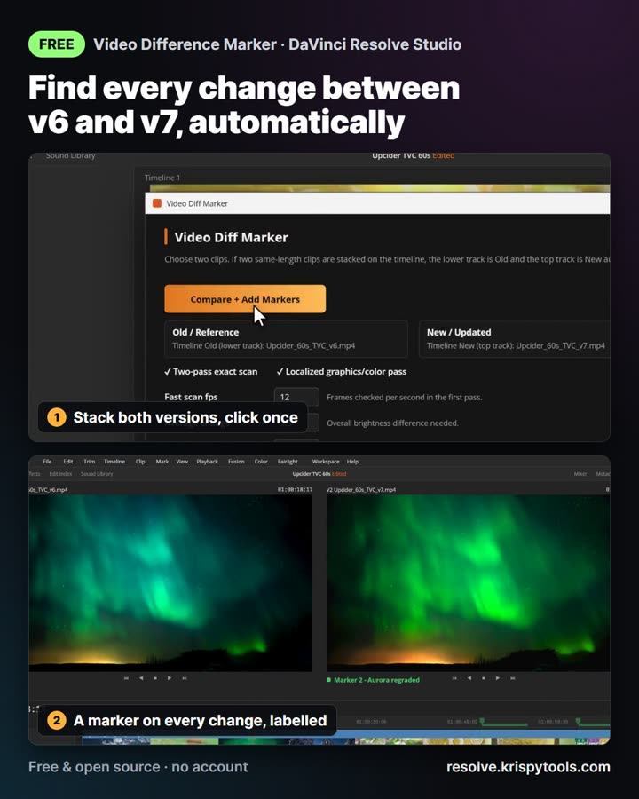</a></td>
<td width="33%"><a href="https://resolve.krispytools.com/tools/resolve-text-toolkit/">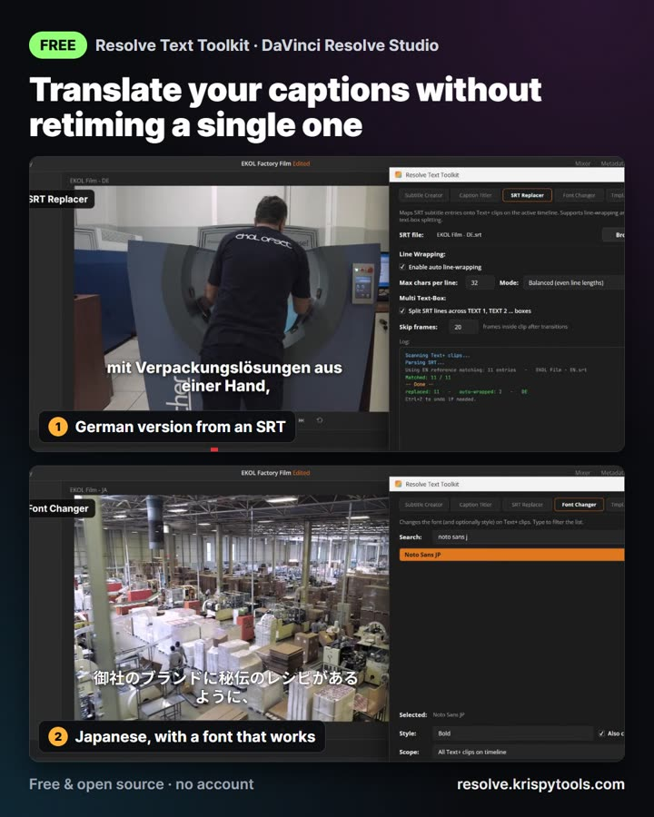</a></td>
<td width="33%"><a href="https://resolve.krispytools.com/tools/marker-range-render-queue/">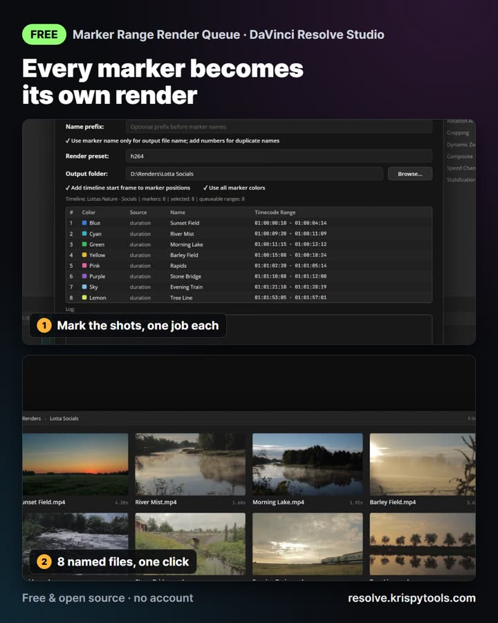</a></td>
</tr>
<tr>
<td width="33%"><a href="https://resolve.krispytools.com/tools/comments-to-resolve-markers/">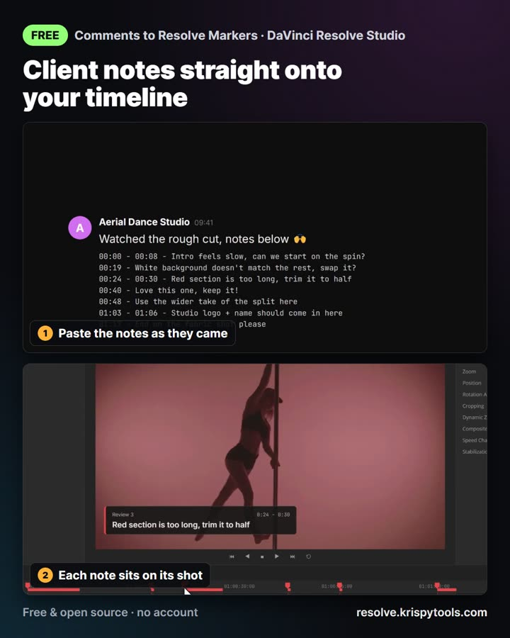</a></td>
<td width="33%"><a href="https://resolve.krispytools.com/tools/youtube-chapter-exporter/">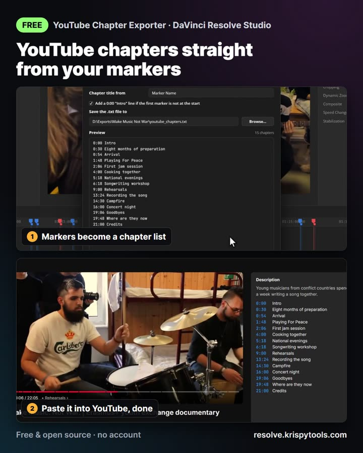</a></td>
<td width="33%"><a href="https://resolve.krispytools.com/tools/resolve-page-time-tracker/">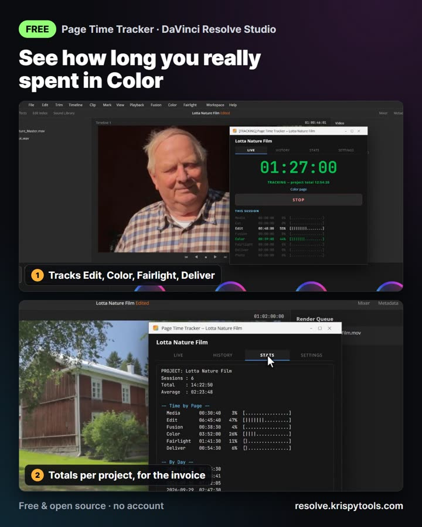</a></td>
</tr>
<tr>
<td width="33%"><a href="https://resolve.krispytools.com/tools/subtitle-creator/">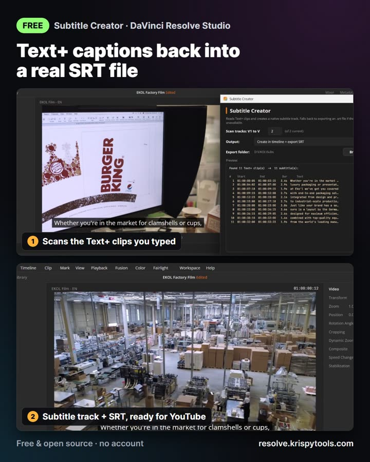</a></td>
<td width="33%"><a href="https://resolve.krispytools.com/tools/batch-export/">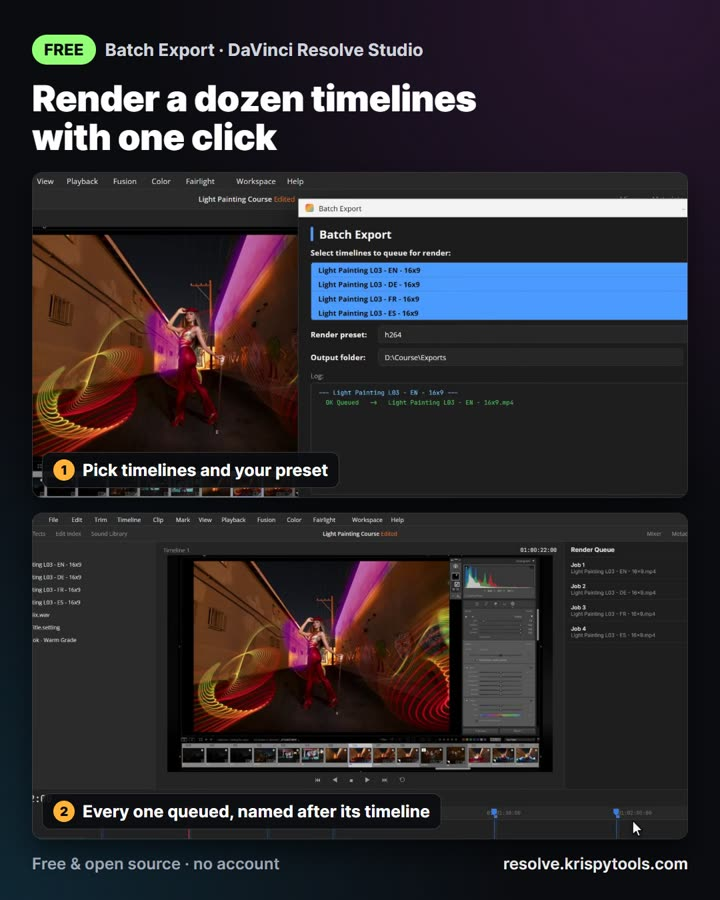</a></td>
<td width="33%"><a href="https://resolve.krispytools.com/tools/timeline-renamer/">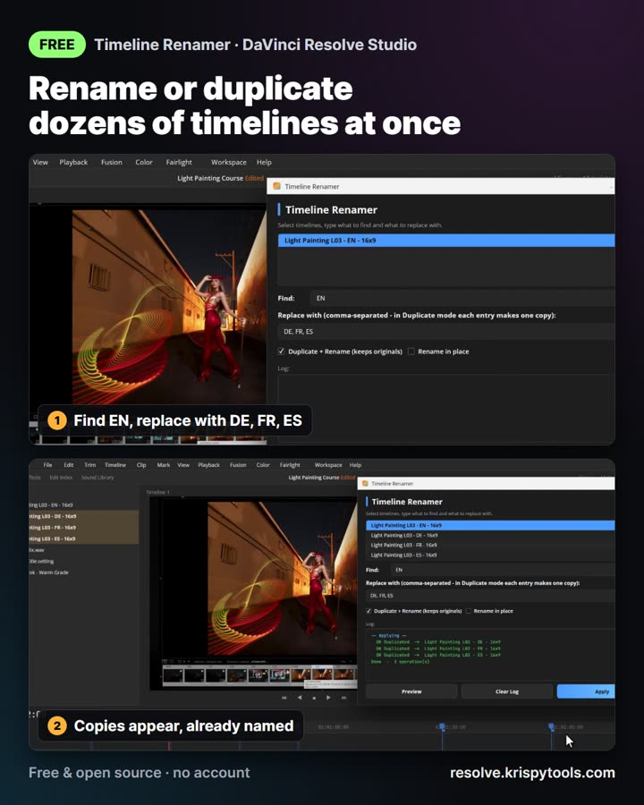</a></td>
</tr>
<tr>
<td width="33%"><a href="https://resolve.krispytools.com/tools/marker-insert/">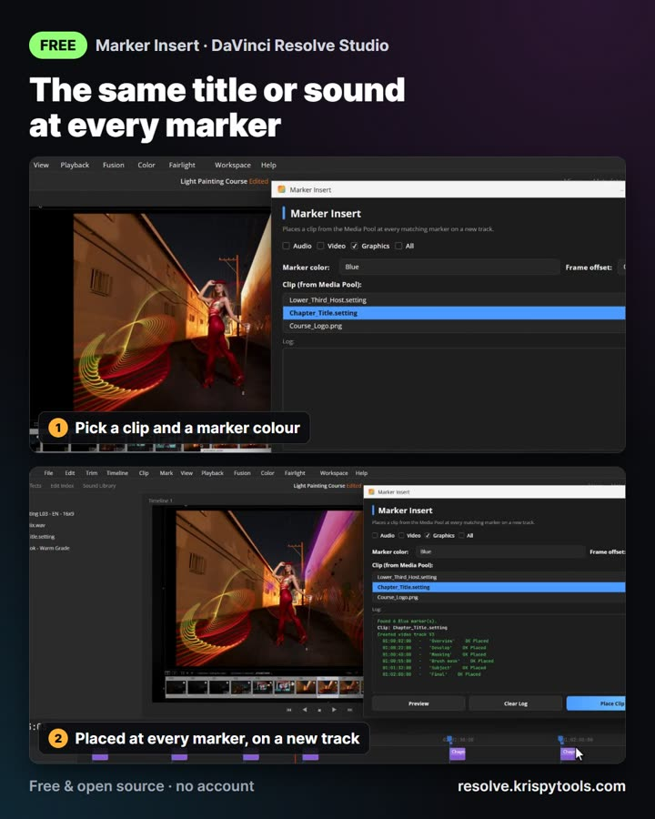</a></td>
<td width="33%"><a href="https://resolve.krispytools.com/tools/track-overlay/">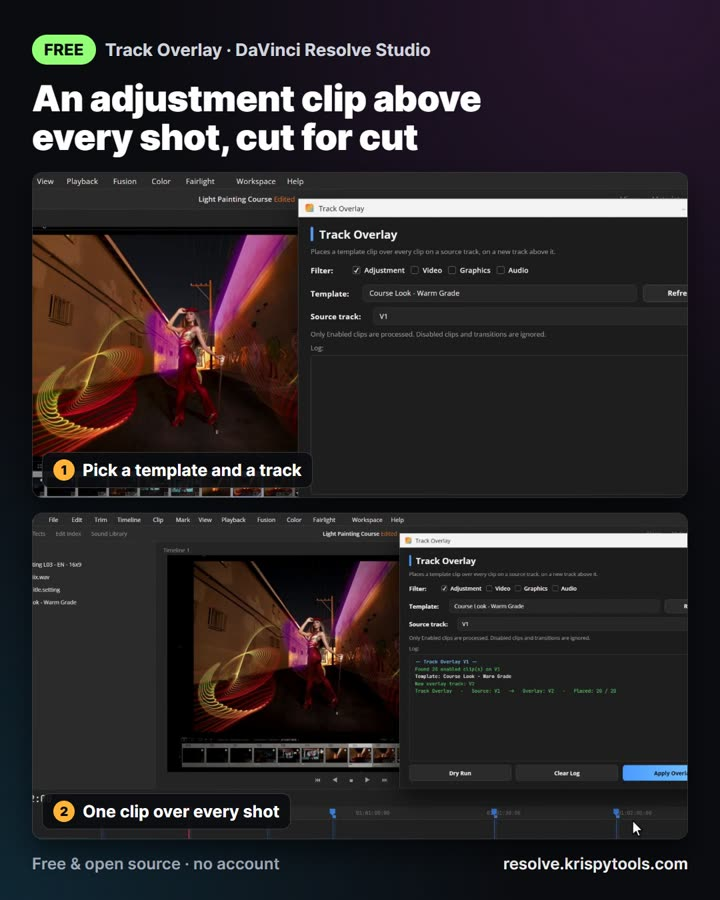</a></td>
<td width="33%"><a href="https://resolve.krispytools.com/tools/marker-screenshots/">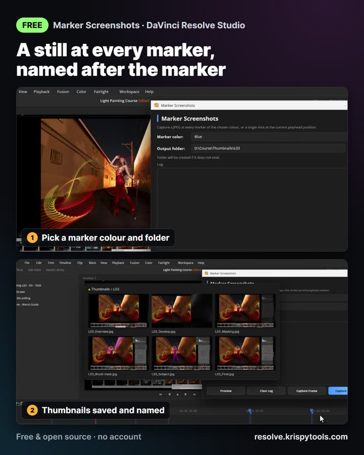</a></td>
</tr>
</table>

Made by Kristaps Prūsis, a video editor in Latvia, for his own work, and shared because they might save you time too.

## Tools

### Bundles

5 tools in 1: one window with 5 pages instead of 5 separate tools to install and open. Each tool inside is also available on its own.

| Tool | What it does | Demo | Script |
|---|---|---|---|
| [Resolve Automator (5 tools in 1)](https://resolve.krispytools.com/tools/resolve-automator/) | Timeline Renamer, Marker Screenshots, Marker Insert, Track Overlay and Batch Export in one window. | [Video](https://resolve.krispytools.com/tools/resolve-automator/) | [`Resolve Automator.lua`](tools/Bundles/Resolve%20Automator.lua) |
| [Resolve Text Toolkit (5 tools in 1)](https://resolve.krispytools.com/tools/resolve-text-toolkit/) | Caption Titler, SRT Replacer, Font Changer, Template Duplicator and Subtitle Creator in one window. | [Video](https://resolve.krispytools.com/tools/resolve-text-toolkit/) | [`Resolve Text Toolkit.lua`](tools/Bundles/Resolve%20Text%20Toolkit.lua) |

### Text

| Tool | What it does | Demo | Script |
|---|---|---|---|
| [Caption Titler](https://resolve.krispytools.com/tools/caption-titler/) | Build styled, animated Text+ captions from subtitles using your own title template. | [YouTube](https://youtu.be/AJtufTwBprc) | [`Caption Titler.lua`](tools/Text/Caption%20Titler.lua) |
| [Font Changer](https://resolve.krispytools.com/tools/font-changer/) | Change the font on every Text+ clip in one click. | [YouTube](https://youtu.be/njY6Przz3rk) | [`Font Changer.lua`](tools/Text/Font%20Changer.lua) |
| [SRT Replacer](https://resolve.krispytools.com/tools/srt-replacer/) | Swap your captions to another language from an SRT, keeping style and timing. | [YouTube](https://youtu.be/G_YipSFSRSs) | [`SRT Replacer.lua`](tools/Text/SRT%20Replacer.lua) |
| [Subtitle Creator](https://resolve.krispytools.com/tools/subtitle-creator/) | Turn Text+ clips into a real Resolve subtitle track and an SRT file. | [YouTube](https://youtu.be/zyH0rNLEiVQ) | [`Subtitle Creator.lua`](tools/Text/Subtitle%20Creator.lua) |
| [Template Duplicator](https://resolve.krispytools.com/tools/template-duplicator/) | Move every caption onto another title template, keeping text and timing. | [YouTube](https://youtu.be/NIXifq0zRBc) | [`Template Duplicator.lua`](tools/Text/Template%20Duplicator.lua) |

### Automation

| Tool | What it does | Demo | Script |
|---|---|---|---|
| [Batch Export](https://resolve.krispytools.com/tools/batch-export/) | Queue many timelines for render with one preset and one output folder. | [YouTube](https://youtu.be/164dyAUp2Qg) | [`Batch Export.lua`](tools/Automation/Batch%20Export.lua) |
| [Marker Insert](https://resolve.krispytools.com/tools/marker-insert/) | Drop the same clip at every marker: a whoosh, a title, a graphic or a video. | [Video](https://resolve.krispytools.com/tools/marker-insert/) | [`Marker Insert.lua`](tools/Automation/Marker%20Insert.lua) |
| [Marker Range Render Queue](https://resolve.krispytools.com/tools/marker-range-render-queue/) | Turn timeline marker ranges into named Deliver-page render jobs. | [YouTube](https://youtu.be/Y5H6EdyOCh4) | [`Marker Range Render Queue.lua`](tools/Automation/Marker%20Range%20Render%20Queue.lua) |
| [Marker Screenshots](https://resolve.krispytools.com/tools/marker-screenshots/) | Save a still at every marker of one colour, named after the marker. | [Video](https://resolve.krispytools.com/tools/marker-screenshots/) | [`Marker Screenshots.lua`](tools/Automation/Marker%20Screenshots.lua) |
| [Timeline Renamer](https://resolve.krispytools.com/tools/timeline-renamer/) | Duplicate or rename many Resolve timelines at once with find and replace. | [YouTube](https://youtu.be/2HFc1IR6s3k) | [`Timeline Renamer.lua`](tools/Automation/Timeline%20Renamer.lua) |
| [Track Overlay](https://resolve.krispytools.com/tools/track-overlay/) | Cover every clip on a track with a template clip, cut for cut. | [Video](https://resolve.krispytools.com/tools/track-overlay/) | [`Track Overlay.lua`](tools/Automation/Track%20Overlay.lua) |
| [Video Difference Marker](https://resolve.krispytools.com/tools/video-difference-marker/) | Compare two video versions and add Resolve markers where visual changes occur. | [Video](https://resolve.krispytools.com/tools/video-difference-marker/) | [`Video Difference Marker.lua`](tools/Automation/Video%20Difference%20Marker.lua) |

### Utilities

| Tool | What it does | Demo | Script |
|---|---|---|---|
| [Comments to Resolve Markers](https://resolve.krispytools.com/tools/comments-to-resolve-markers/) | Paste review notes from anywhere and turn them into Resolve timeline markers. | [YouTube](https://youtu.be/rFFb3p3x3r8) | [`Comments to Resolve Markers.lua`](tools/Utilities/Comments%20to%20Resolve%20Markers.lua) |
| [Resolve Page Time Tracker](https://resolve.krispytools.com/tools/resolve-page-time-tracker/) | Track active editing time by Resolve page, session, and project. | [Video](https://resolve.krispytools.com/tools/resolve-page-time-tracker/) | [`Resolve Page Time Tracker.lua`](tools/Utilities/Resolve%20Page%20Time%20Tracker.lua) |
| [YouTube Chapter Exporter](https://resolve.krispytools.com/tools/youtube-chapter-exporter/) | Turn Resolve timeline markers into a ready-to-paste YouTube chapter list. | [YouTube](https://youtu.be/TniY1OCkV7o) | [`YouTube Chapter Exporter.lua`](tools/Utilities/YouTube%20Chapter%20Exporter.lua) |

## Install

1. Download the `.lua` file of the tool you want, or the whole repo as a ZIP (green **Code** button > Download ZIP).
2. Copy it into Resolve's Utility scripts folder:
   - **Windows:** `%APPDATA%\Blackmagic Design\DaVinci Resolve\Support\Fusion\Scripts\Utility\`
   - **macOS:** `~/Library/Application Support/Blackmagic Design/DaVinci Resolve/Fusion/Scripts/Utility/`
3. Restart Resolve and open the tool from **Workspace > Scripts > Utility**.

## Requirements

- **DaVinci Resolve Studio 19.1 or newer.** Since Resolve 19.1 the free version no longer lets scripts open their own window.
- Windows 10/11 or macOS 12+. One file works on both.
- Video Difference Marker also needs [FFmpeg](https://ffmpeg.org) installed.

Tested in Resolve Studio 21 on Windows 11. macOS support is built in but less tested, so if something breaks on your Mac, please open an issue.

## Bugs and ideas

Open an [issue](../../issues) with your Resolve version, your OS and what happened. Pull requests are welcome.

## Support the project

Everything here is free, also for paid client work. If a tool saved you time, you can [say thanks with any amount](https://buy.polar.sh/polar_cl_O8uLLTvEdos0GJEM7GCTxUdUN4MGWKijaK9a634Bls4). Never required.

## License

[MIT](LICENSE)
